# Authentication Flow - Sequence Diagram

## Complete Authentication Sequence for All User Types

```mermaid
sequenceDiagram
    participant User
    participant UI as Web UI<br/>(Next.js)
    participant AuthCtx as Auth Context
    participant API as API Client
    participant Server as NestJS API
    participant DB as PostgreSQL
    participant Storage as Browser Storage

    Note over User,Storage: REGISTRATION FLOW (Owner)

    User->>UI: Navigate to /register
    UI->>UI: Check if already authenticated
    alt Already authenticated
        UI->>UI: Redirect to dashboard
    else Not authenticated
        UI->>User: Display registration form
        User->>UI: Enter name, email, password, phone
        UI->>UI: Real-time validation
        UI->>User: Show validation feedback
        
        User->>UI: Submit registration form
        UI->>AuthCtx: register(data)
        AuthCtx->>API: POST /api/v1/auth/register
        API->>Server: Register request
        
        Server->>DB: Check if email exists
        alt Email exists
            DB-->>Server: User found
            Server-->>API: 409 Conflict
            API-->>AuthCtx: Error: User exists
            AuthCtx-->>UI: Show error message
            UI-->>User: Display error
        else Email available
            DB-->>Server: Email available
            Server->>Server: Hash password (bcrypt)
            Server->>DB: Create user (role: owner)
            DB-->>Server: User created
            Server->>Server: Generate JWT token
            Server-->>API: 200 OK {access_token, user}
            API-->>AuthCtx: Success response
            AuthCtx->>Storage: Store token & user data
            AuthCtx->>UI: Update auth state
            UI->>UI: Redirect to /dashboard (owner)
            UI->>User: Show dashboard
        end
    end

    Note over User,Storage: LOGIN FLOW (All User Types)

    User->>UI: Navigate to /login
    UI->>UI: Check if already authenticated
    alt Already authenticated
        UI->>UI: Redirect based on role
    else Not authenticated
        UI->>User: Display login form
        User->>UI: Enter email & password
        User->>UI: Check "Remember me" (optional)
        User->>UI: Submit login form
        
        UI->>AuthCtx: login(email, password, rememberMe)
        AuthCtx->>API: POST /api/v1/auth/login
        API->>Server: Login request
        
        Server->>DB: Find user by email
        alt User not found
            DB-->>Server: No user
            Server-->>API: 401 Unauthorized
            API-->>AuthCtx: Error: Invalid credentials
            AuthCtx-->>UI: Show error message
            UI-->>User: Display error
        else User found
            DB-->>Server: User data
            Server->>Server: Verify password (bcrypt.compare)
            alt Password invalid
                Server-->>API: 401 Unauthorized
                API-->>AuthCtx: Error: Invalid credentials
                AuthCtx-->>UI: Show error message
                UI-->>User: Display error
            else Password valid
                Server->>Server: Generate JWT token
                Server-->>API: 200 OK {access_token, user}
                API-->>AuthCtx: Success response
                AuthCtx->>Storage: Store token & user data<br/>(localStorage if rememberMe,<br/>sessionStorage otherwise)
                AuthCtx->>UI: Update auth state
                
                alt User role is Owner
                    UI->>UI: Redirect to /dashboard
                    UI->>User: Show admin dashboard
                else User role is Manager
                    UI->>UI: Redirect to /dashboard
                    UI->>User: Show operations dashboard
                else User role is Cashier
                    UI->>UI: Redirect to /pos
                    UI->>User: Show POS interface
                end
            end
        end
    end

    Note over User,Storage: PROTECTED ROUTE ACCESS

    User->>UI: Navigate to /dashboard (or any protected route)
    UI->>UI: Middleware checks authentication
    UI->>Storage: Get token
    alt No token
        UI->>UI: Redirect to /login?redirect=/dashboard
        UI->>User: Show login page
    else Token exists
        UI->>AuthCtx: Check authentication state
        AuthCtx->>API: GET /api/v1/auth/profile<br/>(with token in header)
        API->>Server: Profile request with token
        Server->>Server: Verify JWT token
        alt Token invalid/expired
            Server-->>API: 401 Unauthorized
            API-->>AuthCtx: Error
            AuthCtx->>Storage: Clear token & user data
            AuthCtx->>UI: Update auth state (logged out)
            UI->>UI: Redirect to /login
            UI->>User: Show login page
        else Token valid
            Server->>DB: Get user data
            DB-->>Server: User data
            Server-->>API: 200 OK {user}
            API-->>AuthCtx: User data
            AuthCtx->>UI: User authenticated
            
            UI->>UI: Check route permissions
            alt User has required role/permission
                UI->>UI: Render protected page
                UI->>User: Show page content
            else User lacks permission
                UI->>UI: Redirect to /unauthorized
                UI->>User: Show unauthorized message
            end
        end
    end

    Note over User,Storage: LOGOUT FLOW

    User->>UI: Click logout button
    UI->>AuthCtx: logout()
    AuthCtx->>Storage: Clear token & user data
    AuthCtx->>UI: Update auth state (logged out)
    UI->>UI: Redirect to /login
    UI->>User: Show login page with "Logged out" message

    Note over User,Storage: TOKEN REFRESH (Future)

    UI->>API: API request with token
    API->>Server: Request with token
    alt Token expired
        Server-->>API: 401 Unauthorized
        API->>AuthCtx: Token expired
        AuthCtx->>API: POST /api/v1/auth/refresh<br/>(with refresh token)
        API->>Server: Refresh token request
        alt Refresh token valid
            Server->>Server: Generate new access token
            Server-->>API: 200 OK {access_token}
            API-->>AuthCtx: New token
            AuthCtx->>Storage: Update token
            AuthCtx->>API: Retry original request
        else Refresh token invalid
            Server-->>API: 401 Unauthorized
            API-->>AuthCtx: Refresh failed
            AuthCtx->>Storage: Clear all auth data
            AuthCtx->>UI: Logout user
            UI->>UI: Redirect to /login
        end
    end
```

## Role-Specific Flows

### Owner Registration & Login
1. Owner registers → Creates account with `role: owner`
2. Owner logs in → Redirected to `/dashboard` (admin dashboard)
3. Owner has access to all features and routes

### Manager Invitation & Login
1. Owner/Admin sends invitation → Manager receives link
2. Manager clicks invitation → Pre-filled registration with `role: manager`
3. Manager completes registration → Account created, linked to tenant
4. Manager logs in → Redirected to `/dashboard` (operations dashboard)
5. Manager has access to operations features (no admin access)

### Cashier Invitation & Login
1. Owner/Manager sends invitation → Cashier receives link
2. Cashier clicks invitation → Pre-filled registration with `role: cashier`
3. Cashier completes registration → Account created, linked to tenant
4. Cashier logs in → Redirected to `/pos` (POS interface)
5. Cashier has access only to POS and sales features

