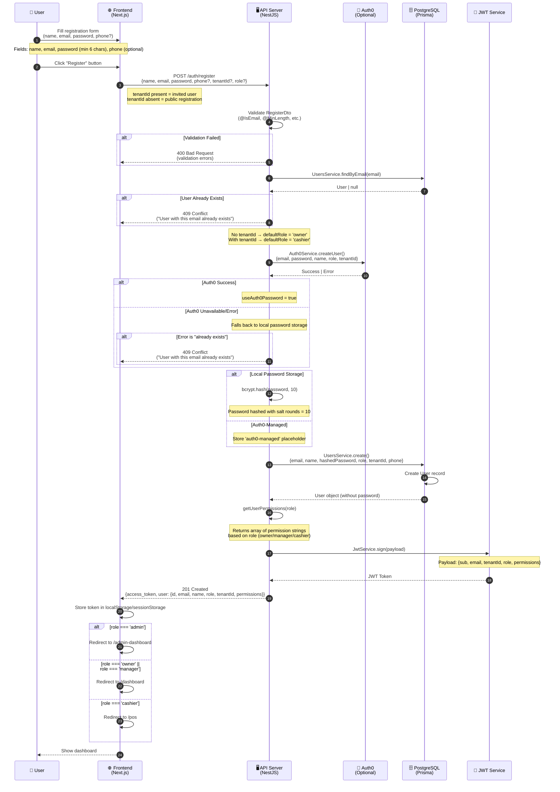

# User Registration Sequence Diagram

## Overview

This document shows the sequence diagram for the user registration flow in ZakPos. The registration supports both **public registration** (creates Owner) and **invited registration** (creates Cashier/Manager within a tenant).

---

## Sequence Diagram: User Registration



---

## Registration Flow Steps

### Step 1: User Fills Form
| Field | Type | Required | Description |
|-------|------|----------|-------------|
| name | string | Yes | Full name |
| email | email | Yes | Unique email address |
| password | string | Yes | Min 6 characters |
| phone | string | No | Phone number |
| tenantId | string | No | For invited users |
| role | string | No | Override default role |

### Step 2: API Validation
- NestJS class-validator validates DTO
- Returns 400 if validation fails

### Step 3: Duplicate Check
- Checks `UsersService.findByEmail(email)`
- Returns 409 if user exists

### Step 4: Role Assignment Logic
```typescript
const defaultRole = registerDto.tenantId ? 'cashier' : 'owner';
const userRole = registerDto.role || defaultRole;
```

| Scenario | tenantId | Resulting Role |
|----------|----------|----------------|
| Public registration | undefined | owner |
| Invited by owner | "tenant-123" | cashier (or provided role) |

### Step 5: User Creation
- Attempts Auth0 creation first (if configured)
- Falls back to local bcrypt-hashed password
- Creates user in PostgreSQL via Prisma

### Step 6: JWT Generation
```typescript
const payload = {
  email: localUser.email,
  sub: localUser.id,
  tenantId: localUser.tenantId,
  role: localUser.role,
  permissions: permissions,
};
return {
  access_token: jwtService.sign(payload),
  user: { id, email, name, role, tenantId, permissions }
};
```

---

## API Response

### Success (201 Created)
```json
{
  "access_token": "eyJhbGciOiJIUzI1NiIsInR5cCI6IkpXVCJ9...",
  "user": {
    "id": "usr_abc123",
    "email": "john@example.com",
    "name": "John Doe",
    "role": "owner",
    "tenantId": "tenant-1",
    "permissions": [
      "user:create", "user:read", "user:update", "user:delete",
      "product:create", "product:read", "product:update", "product:delete",
      "inventory:create", "inventory:read", "inventory:update", "inventory:delete",
      "sale:create", "sale:read", "sale:update", "sale:delete",
      "report:read", "report:export",
      "tenant:manage"
    ]
  }
}
```

### Error Responses

| Status | Error | When |
|--------|-------|------|
| 400 | Bad Request | Validation failed |
| 409 | Conflict | Email already exists |

---

## Frontend Redirect Logic

```typescript
if (response.user.role === 'admin') {
  router.push(ROUTES.ADMIN_DASHBOARD);
} else if (response.user.role === 'owner' || response.user.role === 'manager') {
  router.push(ROUTES.DASHBOARD);
} else if (response.user.role === 'cashier') {
  router.push(ROUTES.POS);
} else {
  router.push(ROUTES.DASHBOARD);
}
```

| Role | Redirect To |
|------|-------------|
| admin | /admin-dashboard |
| owner | /dashboard |
| manager | /dashboard |
| cashier | /pos |

---

## Permission Matrix by Role

| Permission | Owner | Manager | Cashier |
|------------|-------|---------|---------|
| user:create | ✅ | ❌ | ❌ |
| user:read | ✅ | ✅ | ❌ |
| user:update | ✅ | ✅ | ❌ |
| user:delete | ✅ | ❌ | ❌ |
| product:create | ✅ | ✅ | ❌ |
| product:read | ✅ | ✅ | ✅ |
| product:update | ✅ | ✅ | ❌ |
| product:delete | ✅ | ✅ | ❌ |
| inventory:* | ✅ | ✅ | read only |
| sale:* | ✅ | ✅ | create, read |
| invoice:* | ✅ | ✅ | read, send, confirm |
| report:read | ✅ | ✅ | ✅ |
| report:export | ✅ | ❌ | ❌ |
| tenant:manage | ✅ | ❌ | ❌ |

---

## Related Documents

- [UI-DOC-05: Owner Login](./UI-DOC-05-OWNER-LOGIN.md)
- [UI-DOC-01: Admin Login](./UI-DOC-01-ADMIN-LOGIN.md)
- [UI-DOC-14: User Management](./UI-DOC-14-USER-MANAGEMENT.md)

---

## Changelog

| Version | Date | Author | Changes |
|---------|------|--------|---------|
| 1.0 | 2026-03-23 | Claude | Initial diagram creation |
